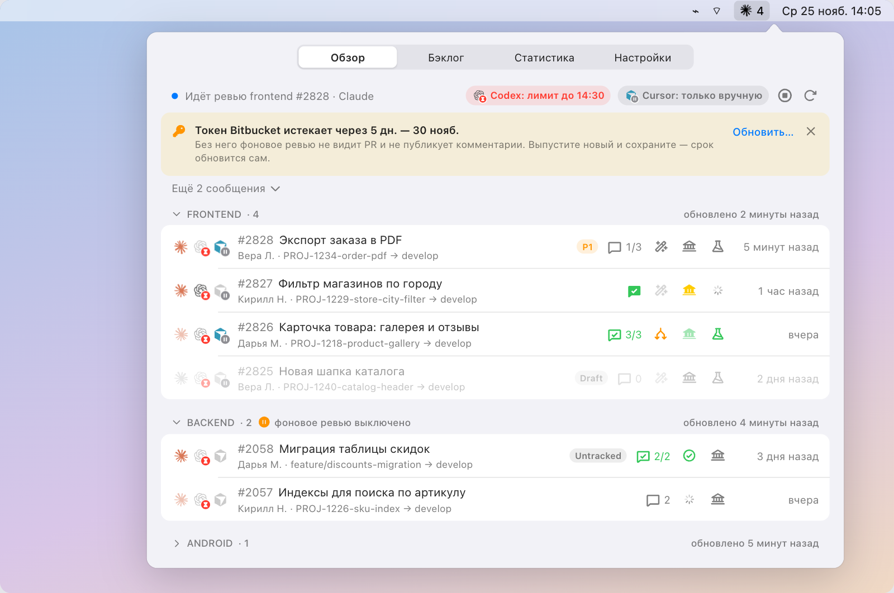
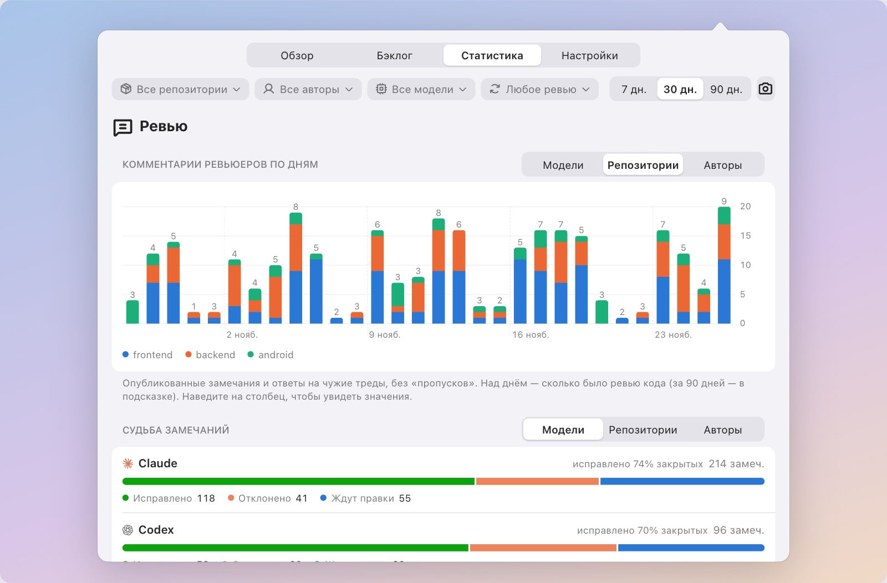

# PR Reviewer

**English** · [Русский](README.ru.md)

Background code review of open Bitbucket pull requests by three models — Claude, Codex and Cursor — with a tray app for macOS and Windows.


<sub>Mockup with made-up data</sub>

> This is the author's personal tool, published as a showcase: the code, the architecture, and how the product was built by a team of AI agents. No support or compatibility between versions is promised. It works with **Bitbucket Cloud only**; GitHub is not supported. The interface and most of the project documents are in Russian.

Every few minutes the service looks at open pull requests in the connected repositories. When there is a new commit or a new thread, the models read the changes one after another and post findings with levels P0–P3. Each next model checks the previous one's findings: if it agrees, it adds a mark; if not, it replies with a reason. When the code is fixed or the team explains it is intended, the model resolves its own thread. Models only read code and return JSON; the service itself posts, signs and anchors findings to diff lines. Repositories are reviewed in parallel (`parallelRepos`, 3 by default).

Besides review:

- **fixing by findings** — Claude edits the code for open threads, runs the checks and pushes to the PR branch; or rebases it onto the target branch;
- **architecture review** — is the task solved the right way at all: alternatives, simpler options, serious risks;
- **testing in a browser** — a plan, then Vitest and Playwright tests against a local backend in Docker;
- **backlog** — problems that existed before the PR do not clutter it but are collected for triage;
- **reviewer memory** — rules learned from the team's replies, so models do not repeat rejected findings;
- **statistics** — noise, share of fixed findings, model comparison, cost at API prices.

Everything is controlled from the tray app (a popover at the icon); the CLI can do the same: `bin/pr-reviewer help`.


<sub>Mockup with made-up data</sub>

## How it works

```
Model CLIs (claude, codex, cursor-agent)
        ▲  prompt, JSON by schema
        │
Service (Node, src/) ──► Bitbucket Cloud: threads, build status
  scheduled worker (launchd / systemd)
  CLI bin/pr-reviewer
  local HTTP API 127.0.0.1:8765 + SSE
        ▲  token from a 600 file
        │
Tray app (Tauri 2: Rust + React, app/)
```

- **Service** (`src/`) — the worker goes over open PRs, calls the models through their CLIs and posts the findings itself: models only read code and return JSON by the schemas in `schema/`. Fixing, architecture review, testing, memory, backlog and statistics live here too. Data is JSON/JSONL files in the data folder.
- **API** (`src/api.mjs`, `schema/api.openapi.json`) — the app's only door to the service: data reads, actions through the same CLI, a change stream over SSE.
- **App** (`app/`) — a tray icon and a popover on macOS and Windows. The client and types are generated from the OpenAPI schema. Styles and icons come from the design system in `product/design/web/`.
- On Windows the service runs in WSL2 and the app in Windows itself; WSL forwards `localhost` between them.

## How it was built

The product was built by a team of Claude Code sessions led by the author: PM, dev, designer and qa. The author set goals and made decisions; the roles worked in separate sessions and messaged each other directly. Everything they left is in the repository:

- [`product/backlog.md`](product/backlog.md) — the team's rules: roles, message routes, the board, how a task goes from idea to check. The tasks themselves are on the [GitHub board](https://github.com/users/AVor0n/projects/10) and in issues; early history is in [`product/archive/`](product/archive/).
- [`product/specs/`](product/specs/) — PM specifications. Questions to the author are numbered across the whole project (Q1, Q2, …) with the decisions next to them.
- [`product/design/`](product/design/) — HTML mockups, screen specifications and the design system [`web/`](product/design/web/) the app takes its styles and icons from.
- [`product/bugs/`](product/bugs/) — qa reports: what was checked, how, what was found and what the author decided.
- The git history — commits by the roles with a `Co-Authored-By: Claude` line.

## Requirements

- macOS, Node 22+ with npm, `git`, Rust ([rustup](https://rustup.rs); `install.sh` takes the version from `app/rust-toolchain.toml`) — the app is built from source. Or Linux with systemd, including WSL2 on Windows 11: the service runs there and the app is installed in Windows, see "Linux and WSL2" and "Tray app".
- Model CLIs in `PATH`: `claude` and `codex` (signed in with `codex login`); `cursor-agent` is optional.
- Docker — only for browser testing.
- [uv](https://docs.astral.sh/uv/) — optional: `install.sh` uses it to install Graphify (a code graph for the rule-selection research). Without uv the research runs without the graph.
- An Atlassian API token with Bitbucket access and SSH access to the repositories.

## Installation (macOS)

1. **Config.** `cp config.example.json config.json` (or just run `./install.sh` — on the first run it copies the example and stops). Fill in `bitbucket.email` and `repos` (`workspace`, `slug`, SSH `remote`, optional `source` — a local copy for a faster first clone). Repositories can also be added later in the app settings. All fields are described in `schema/config.schema.json`; editors show the descriptions.

2. **Bitbucket token** — an [Atlassian API token](https://id.atlassian.com/manage-profile/security/api-tokens) with scopes `read:repository:bitbucket`, `read:pullrequest:bitbucket`, `write:pullrequest:bitbucket`:

    ```bash
    read -rs 'TOKEN?Bitbucket token: ' && security add-generic-password -U -s pr-reviewer-bitbucket -a <email> -T /usr/bin/security -w "$TOKEN"; unset TOKEN
    ```

    Do not use `security … -w` without a value: interactive input is cut to 128 characters, and Bitbucket then answers 401.

3. **Claude token** — a regular session expires in the background, so a long-lived token from `claude setup-token` is needed:

    ```bash
    read -rs 'TOKEN?Claude token: ' && security add-generic-password -U -s pr-reviewer-claude -a claude -T /usr/bin/security -w "$TOKEN"; unset TOKEN
    ```

4. **Cursor key** (optional) — an API key from the [Cursor settings](https://cursor.com/dashboard?tab=integrations), with the same command and `-s pr-reviewer-cursor`. Without it, take Cursor out of background review: `bin/pr-reviewer agent set cursor --auto off`.

5. **Install:**

    ```bash
    ./install.sh
    ```

    The script checks the CLIs, the config and the tokens, creates `bin/pr-reviewer`, builds the app `~/Applications/PR Reviewer.app` (Tauri; the first build takes a few minutes) and registers three launchd agents: the worker, the local API and the app, which starts at login. The first install leaves background review off.

6. **Check without publishing** (the models really run, nothing goes to Bitbucket):

    ```bash
    bin/pr-reviewer run --dry-run --pr <id>
    ```

7. **Turn on** — the "Background review" switch in the app settings or `bin/pr-reviewer resume`.

## Updating

Changes in `src/` and `schema/` apply at once. Changes in `app/` and `product/design/web/` (the app's styles and icons) apply after rebuilding the app:

```bash
./install.sh --app-only
```

A full reinstall (`./install.sh`) is needed when `install.sh` changed or `node`, `claude`, `codex`, `cursor-agent` moved. It waits for the current review pass to end and says what is running; Ctrl+C cancels. `./install.sh --now` installs at once and interrupts the pass. The installed build is shown at the bottom of the app settings.

Token expiry is counted from the date the token was saved to the Keychain (`tokenLifetimeDays`); the app warns with a banner 14 days ahead. A new token is saved with the same `security add-generic-password -U …` command.

## Where things are

| Path | What it is |
|---|---|
| `config.json` | Personal config (in `.gitignore`); example — `config.example.json` |
| `api-token` in the data folder | Local API token (mode 600) |
| Keychain: `pr-reviewer-bitbucket`, `pr-reviewer-claude`, `pr-reviewer-cursor` | Tokens |
| `~/Library/Application Support/pr-reviewer/` | State, queue, statistics, memory, backlog, limits |
| `~/Library/Logs/pr-reviewer/worker.log` | Service log ("Log" sheet in the app settings) |
| `~/Applications/PR Reviewer.app` | The tray app; autostart agent `com.avoronin.pr-reviewer.tray` |
| `~/.pr-reviewer/` | Service clones of the repositories and work folders for fixing, architecture review and testing; `graphify-venv/` and `graphs/` — Graphify and code graphs |

## Troubleshooting

- **The service does nothing** — background review is off (`bin/pr-reviewer status`), the pass is not due yet by `intervalMinutes` (▶ in the overview runs it now), or the launchd agent (on Linux — `pr-reviewer.timer`) is not loaded (`./install.sh`).
- **A model does not review a PR** — hover over the grey "0" in the PR row and over the model icon: the tooltips name the reason (draft, branch outside `branchPattern`, background review off, limit, manual-only model). Clicking the model icon starts a review manually.
- **Bitbucket 401 / 403** — wrong email or a cut token / the token lacks scopes. Save the token again with the command above.
- **The pass is stuck** (tray icon with an orange triangle) — "Stop" in the banner or `bin/pr-reviewer stop`.
- **A change in `app/` or the styles is not visible** — `./install.sh --app-only`.
- **No tray icon** — the app was closed with "Quit": `open ~/Applications/PR\ Reviewer.app` or `launchctl kickstart gui/$(id -u)/com.avoronin.pr-reviewer.tray`.
- **"Memory is broken" banner** — the memory file is damaged; the banner shows its path, fix the file by hand.
- Details on any error are in the log: Settings → Log, or `worker.log`.

## Linux and WSL2

The service runs on Linux and in WSL2 the same way as on macOS. On Windows the tray app connects to it (see "Tray app"): WSL2 forwards `localhost`, and the app talks to the service API. On Linux without Windows there is no app: review results are visible in Bitbucket (an "AI-review" build status on the PR commit, `buildStatus.enabled`, and findings in threads), and the service is controlled with `bin/pr-reviewer` (`status`, `run-now`, `pause`, `resume`, `help`).

| | macOS | Linux / WSL2 |
|---|---|---|
| Secrets | Keychain | libsecret (`secret-tool`) when a working keyring exists, otherwise `~/.config/pr-reviewer/secrets.json` with mode 600 |
| Schedule | launchd | systemd: `pr-reviewer.timer` once a minute and `pr-reviewer.service` |
| Stay awake during a pass | `caffeinate` | `systemd-inhibit` when available |
| Data | `~/Library/Application Support/pr-reviewer/` | `~/.local/share/pr-reviewer/` |
| Logs | `~/Library/Logs/pr-reviewer/` | `~/.local/state/pr-reviewer/` |

### Installing on Windows 11 (WSL2)

1. **Moving from a Mac** (optional) — export the data (memory, statistics, outcomes, backlog, state, `config.json`; no secrets, clones or work folders):

    ```bash
    bin/pr-reviewer data export ~/Desktop/pr-reviewer-export.tar.gz
    ```

    Stop the service on the Mac so that two machines do not review the same PRs: `./uninstall.sh` (data stays).

2. **In Windows** install Ubuntu in WSL2 (`wsl --install -d Ubuntu` in PowerShell) and enable systemd in it:

    ```bash
    printf '[boot]\nsystemd=true\n' | sudo tee /etc/wsl.conf
    ```

    then run `wsl --shutdown` in PowerShell and open Ubuntu again.

3. **In Ubuntu** install Node 22+ (for example with [nvm](https://github.com/nvm-sh/nvm)), `git`, the model CLIs (`claude`, `codex`, optionally `cursor-agent`), optionally `uv`. Sign in to Codex: `codex login`. Add an SSH key with access to the repositories (`ssh -T git@bitbucket.org` should answer).

4. Clone PR Reviewer into the Linux home folder (not into `/mnt/c/…`: git and Node are slow there). When moving from a Mac, import the archive (Windows paths are visible as `/mnt/c/Users/<name>/…`):

    ```bash
    node src/cli.mjs data import /mnt/c/Users/<name>/Desktop/pr-reviewer-export.tar.gz
    ```

    The import names Mac paths in `config.json` (for example `repos[].source`); local copies are optional — the service removes such paths and clones the repositories over SSH on the first pass. Otherwise create `config.json` from `config.example.json`.

5. Save the tokens — the command asks for the value and does not show it:

    ```bash
    node src/cli.mjs secret set bitbucket
    node src/cli.mjs secret set claude
    node src/cli.mjs secret set cursor
    ```

    `cursor` — only if Cursor is enabled. Check without printing values: `node src/cli.mjs secret status`.

6. Install and check:

    ```bash
    ./install.sh
    systemctl --user status pr-reviewer.timer
    bin/pr-reviewer run --dry-run --pr <id>
    ```

    The service reviews in the background while WSL runs. To keep it independent of an open terminal, `install.sh` enables `loginctl enable-linger` (if it cannot, it prints the `sudo` command). Log — `~/.local/state/pr-reviewer/worker.log`.

7. Install the tray app in Windows — see "Tray app".

**Limitations.** WSL runs while Windows is awake: turn off sleep in "Settings → System → Power" if reviews are needed at night. Where `cursor-agent` keeps its sign-in on Linux is not checked yet — if Cursor does not start, take it out of background review: `bin/pr-reviewer agent set cursor --auto off`.

## Local API

For the tray app the service keeps an HTTP API on `127.0.0.1:8765` (port — `api.port` in `config.json`). It is a separate long-running process: launchd agent `com.avoronin.pr-reviewer.api` on macOS, `pr-reviewer-api.service` on Linux; `./install.sh` sets it up. Every request carries `Authorization: Bearer <token>`; the token is in a file with mode 600 (path — `bin/pr-reviewer api token-path`). Requests are accepted only from this machine, CORS only for the Tauri app. Actions run the same commands as the CLI; the API never returns secret values. Changes come as a `GET /events` stream (SSE). All resources are described in `schema/api.openapi.json`; the server log is `api.err.log` next to `worker.log`.

## Tray app

The macOS and Windows app is in `app/` (Tauri 2, React, TypeScript). A tray icon with a popover: "Overview" (PRs by repository, banners, run, pause, model limits), "Backlog", "Statistics", "Settings" with the log, report sheets (fixing, architecture review, testing, memory). A right-click menu, system notifications — clicking opens the PR or thread. The app works only through the local API: the client and types are generated from `schema/api.openapi.json` (`npm run gen:api` in `app/`). Styles and icons come from `product/design/web`.

**macOS** — installed by `./install.sh` (see "Installation"), rebuilt with `./install.sh --app-only`.

**Windows.** The service runs in WSL ("Linux and WSL2"), the app in Windows itself:

1. Check that the service API is running: in Ubuntu `systemctl --user status pr-reviewer-api` shows `active`.
2. Download the Windows installer `PR Reviewer_…_x64-setup.exe` from the [latest release](https://github.com/AVor0n/pr-reviewer/releases/latest) and run it. It is not signed: on the first run choose "More info → Run anyway".
3. The icon appears in the notification area (it may be hidden under the ^ arrow — drag it onto the taskbar). Left click — popover, right click — menu. The app adds itself to autostart.
4. If the API is stopped, the popover shows "Service is not running" with a PowerShell command: `wsl systemctl --user restart pr-reviewer-api`.

The app opens WSL paths (service clones, `config.json`, test run files) in Explorer and VS Code through `\\wsl.localhost\…`.

**Development.** `cd app && npm ci && npx tauri dev` (Rust per `app/rust-toolchain.toml`). With `PR_REVIEWER_SHOW=1` the dev build shows the popover at once and does not hide it — for screenshots next to mockups. Dev builds have no release CSP: check anything that depends on CSP or windows with `npx tauri build --bundles app`. App tests — `npm test` in `app/`. macOS (`.dmg`) and Windows (`.exe`) builds are made by GitHub Actions. Pushing a tag `app-v*` (the version from `app/src-tauri/tauri.conf.json`, e.g. `app-v0.1.0`) builds both and publishes them on [Releases](https://github.com/AVor0n/pr-reviewer/releases); Actions → **app** → Run workflow builds them as run artifacts without a release.

## Rule selection research

Right now the whole repository memory goes into the review prompt. In shadow mode the service computes which rules selection strategies would pick — by semantic tags (T), by code-graph communities (G) and both (TG) — and writes it to `rule-selection.jsonl`. Reviews do not change. The research is turned on for a repository by creating a tag vocabulary:

```bash
bin/pr-reviewer memory tags init <slug>            # --graph-nolibs — also G′: communities without library nodes
bin/pr-reviewer memory tags show <slug>
bin/pr-reviewer memory selection report [<slug>] [--since <date>]
```

Graphify builds the graph locally (tree-sitter, no LLM, the code goes nowhere) from the main branch of the service clone, once a day.

## Development

`npm test` — core tests (anchoring findings to diff lines, threads, finding outcomes, repository lanes, eviction and rule selection). Test data is made up; live files are never touched. App tests — `npm test` in `app/`.

## Uninstalling

`./uninstall.sh` removes the launchd agents and the app (on Linux — the systemd units) and `bin/`; state, logs and service clones stay. `./uninstall.sh --purge` also removes data and logs. `~/.pr-reviewer/` and the secrets (Keychain entries, on Linux — libsecret or `~/.config/pr-reviewer/secrets.json`) are removed by hand.

## Credits

- Interface icons — [Phosphor Icons](https://phosphoricons.com) (MIT), see [NOTICE](NOTICE).
- The Anthropic (Claude), OpenAI and Cursor logos belong to their respective owners. They only mark which model CLI a review runs on and are not covered by this project's license.

## License

[MIT](LICENSE).
