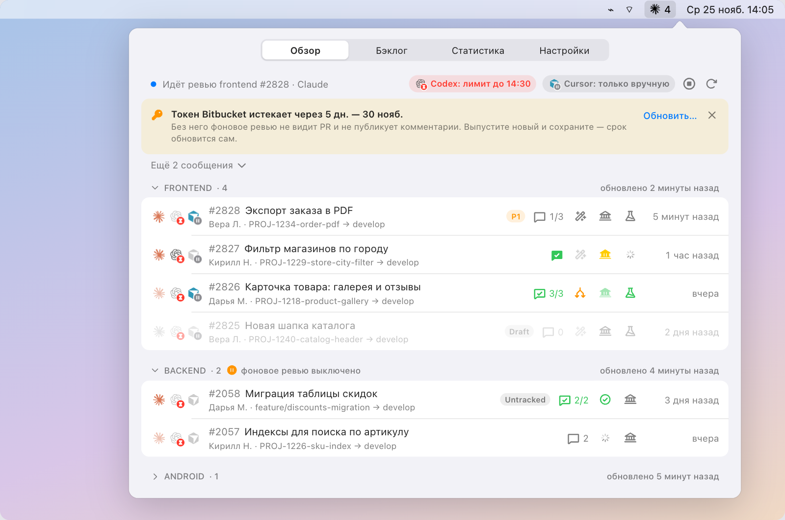
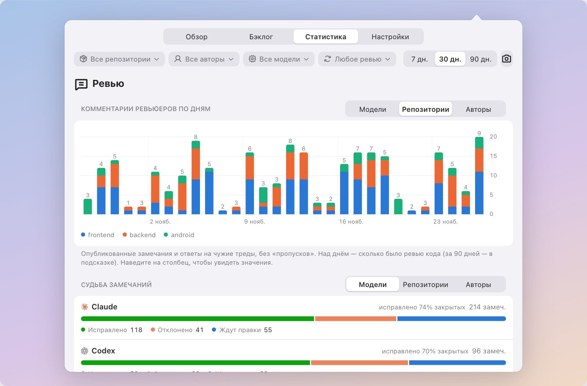

# PR Reviewer

[English](README.md) · **Русский**

Фоновое код-ревью открытых PR в Bitbucket тремя моделями — Claude, Codex и Cursor — с приложением в трее для macOS и Windows.


<sub>Макет с выдуманными данными</sub>

> Это личный инструмент автора, открытый как витрина: код, архитектура и то, как продукт строила команда агентов. Поддержка и совместимость между версиями не обещаются. Работает только с **Bitbucket Cloud**; GitHub не поддерживается.

Раз в несколько минут сервис смотрит открытые PR подключённых репозиториев. Если появился новый коммит или новый тред, модели по очереди читают изменения и публикуют замечания уровнями P0–P3. Следующая модель проверяет замечания предыдущей: согласна — ставит отметку, не согласна — отвечает с причиной. Когда код исправлен или команда объяснила, что так задумано, модель сама закрывает свой тред. Модели только читают код и возвращают JSON; публикует, подписывает и привязывает замечания к строкам диффа сам сервис. Разные репозитории проверяются параллельно (`parallelRepos`, по умолчанию 3).

Кроме ревью:

- **доработка по замечаниям** — Claude правит код по открытым тредам, прогоняет проверки и пушит в ветку PR; или делает rebase на целевую ветку;
- **архитектурное ревью** — правильно ли вообще решена задача: альтернативы, где можно проще, серьёзные риски;
- **тестирование в браузере** — план и прогон тестов Vitest и Playwright против локального бэкенда в Docker;
- **бэклог** — проблемы, которые были до PR, не засоряют PR, а копятся для разбора;
- **память ревьюеров** — правила из ответов команды, чтобы модели не повторяли отклонённые замечания;
- **статистика** — шум, доля исправленных замечаний, сравнение моделей, цена по тарифам API.

Всё управление — в приложении в трее (поповер у значка); то же самое умеет CLI: `bin/pr-reviewer help`.


<sub>Макет с выдуманными данными</sub>

## Как устроено

```
CLI моделей (claude, codex, cursor-agent)
        ▲  промпт, JSON по схеме
        │
Сервис (Node, src/) ──► Bitbucket Cloud: треды, статус сборки
  воркер по расписанию (launchd / systemd)
  CLI bin/pr-reviewer
  локальный HTTP API 127.0.0.1:8765 + SSE
        ▲  токен из файла 600
        │
Приложение в трее (Tauri 2: Rust + React, app/)
```

- **Сервис** (`src/`) — воркер проходит по открытым PR, вызывает модели через их CLI и сам публикует замечания: модели только читают код и возвращают JSON по схемам из `schema/`. Здесь же доработка, архитектурное ревью, тестирование, память, бэклог, статистика. Данные — файлы JSON/JSONL в папке данных.
- **API** (`src/api.mjs`, `schema/api.openapi.json`) — единственная дверь к сервису для приложения: чтение данных, действия через тот же CLI, поток изменений по SSE.
- **Приложение** (`app/`) — значок в трее и поповер, на macOS и Windows. Клиент и типы генерируются из OpenAPI. Стили и значки — дизайн-система `product/design/web/`.
- На Windows сервис работает в WSL2, приложение — в самой Windows, `localhost` между ними пробрасывает WSL.

## Как это построено

Продукт строила команда сессий Claude Code под руководством автора: PM, dev, designer и qa. Автор ставил цели и принимал решения, роли работали в отдельных сессиях и писали друг другу напрямую. Всё, что они оставили, лежит в репозитории:

- [`product/backlog.md`](product/backlog.md) — правила команды: роли, маршруты сообщений, доска, как задача идёт от идеи до проверки. Сами задачи — на [доске GitHub](https://github.com/users/AVor0n/projects/10) и в issues; ранняя история — [`product/archive/`](product/archive/).
- [`product/specs/`](product/specs/) — спецификации PM. Вопросы к автору пронумерованы сквозь весь проект (Q1, Q2, …), решения записаны рядом с ними.
- [`product/design/`](product/design/) — макеты в HTML, спецификации экранов и дизайн-система [`web/`](product/design/web/), из которой приложение берёт стили и значки.
- [`product/bugs/`](product/bugs/) — отчёты qa: что проверено, как, что найдено и что решил автор.
- История git — коммиты ролей со строкой `Co-Authored-By: Claude`.

## Что нужно

- macOS, Node 22+ с npm, `git`, Rust ([rustup](https://rustup.rs): версию `install.sh` возьмёт из `app/rust-toolchain.toml`) — приложение собирается из исходников. Или Linux с systemd, в том числе WSL2 на Windows 11: там работает сервис, а приложение ставится в Windows, см. «Linux и WSL2» и «Приложение в трее».
- CLI моделей в `PATH`: `claude` и `codex` (вход через `codex login`); `cursor-agent` — по желанию.
- Docker — только для тестирования в браузере.
- [uv](https://docs.astral.sh/uv/) — по желанию: `install.sh` ставит им Graphify (граф кода для исследования подбора правил памяти). Без uv исследование идёт без графа.
- Atlassian API-токен с доступом к Bitbucket и SSH-доступ к репозиториям.

## Установка

1. **Конфиг.** `cp config.example.json config.json` (или просто `./install.sh` — при первом запуске он скопирует пример и остановится). Заполните `bitbucket.email` и `repos` (`workspace`, `slug`, SSH-адрес `remote`, необязательный `source` — локальная копия для быстрого первого клона). Репозитории можно подключить и позже в настройках приложения. Описания всех полей — в `schema/config.schema.json`, их показывает редактор.

2. **Токен Bitbucket** — [API-токен Atlassian](https://id.atlassian.com/manage-profile/security/api-tokens) со scope `read:repository:bitbucket`, `read:pullrequest:bitbucket`, `write:pullrequest:bitbucket`:

    ```bash
    read -rs 'TOKEN?Токен Bitbucket: ' && security add-generic-password -U -s pr-reviewer-bitbucket -a <email> -T /usr/bin/security -w "$TOKEN"; unset TOKEN
    ```

    Не используйте `security … -w` без значения: интерактивный ввод обрезается до 128 символов, и Bitbucket потом отвечает 401.

3. **Токен Claude** — обычная сессия в фоне протухает, нужен долгоживущий токен из `claude setup-token`:

    ```bash
    read -rs 'TOKEN?Токен Claude: ' && security add-generic-password -U -s pr-reviewer-claude -a claude -T /usr/bin/security -w "$TOKEN"; unset TOKEN
    ```

4. **Ключ Cursor** (по желанию) — API-ключ из [настроек Cursor](https://cursor.com/dashboard?tab=integrations), той же командой с `-s pr-reviewer-cursor`. Без него выключите Cursor из фона: `bin/pr-reviewer agent set cursor --auto off`.

5. **Установка:**

    ```bash
    ./install.sh
    ```

    Скрипт проверяет CLI, конфиг и токены, создаёт `bin/pr-reviewer`, собирает приложение `~/Applications/PR Reviewer.app` (Tauri, первая сборка — несколько минут) и регистрирует три агента launchd: воркер, локальный API и приложение — оно стартует при входе. Старое окно SwiftUI, если оно стояло, удаляется. Первая установка оставляет фоновое ревью выключенным.

6. **Проверка без публикации** (модели запускаются по-настоящему, в Bitbucket ничего не уходит):

    ```bash
    bin/pr-reviewer run --dry-run --pr <id>
    ```

7. **Включение** — переключатель «Фоновое ревью» в «Настройках» приложения или `bin/pr-reviewer resume`.

## Обновление

Изменения в `src/` и `schema/` действуют сразу. Изменения в `app/` и `product/design/web/` (стили и значки приложения) — после пересборки приложения:

```bash
./install.sh --app-only
```

Полная переустановка (`./install.sh`) нужна, если изменился `install.sh` или переехали `node`, `claude`, `codex`, `cursor-agent`. Она ждёт конца идущего прохода и пишет, что идёт; Ctrl+C отменяет. `./install.sh --now` ставит сразу и прерывает проход. Какая сборка установлена — строка «Сборка …» внизу «Настроек».

Сроки токенов приложение считает от даты записи в Keychain (`tokenLifetimeDays`) и за 14 дней предупреждает баннером. Новый токен сохраняется той же командой `security add-generic-password -U …`.

## Где что лежит

| Путь | Что это |
|---|---|
| `config.json` | Личный конфиг (в `.gitignore`); пример — `config.example.json` |
| `api-token` в папке данных | Токен локального API (права 600) |
| Keychain: `pr-reviewer-bitbucket`, `pr-reviewer-claude`, `pr-reviewer-cursor` | Токены |
| `~/Library/Application Support/pr-reviewer/` | Состояние, очередь, статистика, память, бэклог, лимиты |
| `~/Library/Logs/pr-reviewer/worker.log` | Журнал сервиса (лист «Журнал» в «Настройках» приложения) |
| `~/Applications/PR Reviewer.app` | Приложение в трее; агент автозапуска `com.avoronin.pr-reviewer.tray` |
| `~/.pr-reviewer/` | Служебные копии репозиториев и рабочие папки доработки, архитектуры, тестирования; `graphify-venv/` и `graphs/` — Graphify и графы кода |

## Если что-то не так

- **Сервис ничего не делает** — фоновое ревью выключено (`bin/pr-reviewer status`), проход ещё не подошёл по `intervalMinutes` (▶ в обзоре запускает сразу) или агент launchd (на Linux — `pr-reviewer.timer`) не загружен (`./install.sh`).
- **Модель не ревьюит PR** — наведите курсор на серый «0» в строке PR и на значок модели: подсказки называют причину (черновик, ветка вне `branchPattern`, выключенное фоновое ревью, лимит, модель только для ручного запуска). Клик по значку модели запускает ревью вручную.
- **Bitbucket 401 / 403** — неверный email или обрезанный токен / у токена нет нужных scope. Пересохраните токен командой выше.
- **Проход завис** (значок в трее с оранжевым треугольником) — «Прервать» в баннере или `bin/pr-reviewer stop`.
- **Правка в `app/` или в стилях не видна** — `./install.sh --app-only`.
- **Значка в трее нет** — приложение закрыли через «Выйти»: `open ~/Applications/PR\ Reviewer.app` или `launchctl kickstart gui/$(id -u)/com.avoronin.pr-reviewer.tray`.
- **Баннер «Память сломана»** — файл памяти повреждён; путь к нему показан в баннере, исправьте файл вручную.
- Подробности по любой ошибке — в журнале: «Настройки» → «Журнал» или `worker.log`.

## Linux и WSL2

Сервис работает на Linux и в WSL2 так же, как на macOS. На Windows к нему подключается приложение в трее (см. «Приложение в трее»): WSL2 пробрасывает `localhost`, и приложение говорит с API сервиса. На Linux без Windows приложения нет: результат ревью виден в Bitbucket (статус «AI-review» на коммите PR, `buildStatus.enabled`, и замечания в тредах), управление — через `bin/pr-reviewer` (`status`, `run-now`, `pause`, `resume`, `help`).

| | macOS | Linux / WSL2 |
|---|---|---|
| Секреты | Keychain | libsecret (`secret-tool`), если есть рабочее хранилище, иначе `~/.config/pr-reviewer/secrets.json` с правами 600 |
| Расписание | launchd | systemd: `pr-reviewer.timer` раз в минуту и `pr-reviewer.service` |
| Не засыпать во время прохода | `caffeinate` | `systemd-inhibit`, если есть |
| Данные | `~/Library/Application Support/pr-reviewer/` | `~/.local/share/pr-reviewer/` |
| Журналы | `~/Library/Logs/pr-reviewer/` | `~/.local/state/pr-reviewer/` |

### Переезд с Mac на Windows 11 (WSL2)

1. **На Mac** выгрузите данные (память, статистику, исходы, бэклог, состояние, `config.json`; секретов, клонов и рабочих папок в архиве нет):

    ```bash
    bin/pr-reviewer data export ~/Desktop/pr-reviewer-export.tar.gz
    ```

    Остановите сервис на Mac, чтобы две машины не ревьюили одни и те же PR: `./uninstall.sh` (данные остаются).

2. **В Windows** поставьте Ubuntu в WSL2 (`wsl --install -d Ubuntu` в PowerShell) и включите в ней systemd:

    ```bash
    printf '[boot]
systemd=true
' | sudo tee /etc/wsl.conf
    ```

    затем в PowerShell `wsl --shutdown` и снова откройте Ubuntu.

3. **В Ubuntu** поставьте Node 22+ (например, через [nvm](https://github.com/nvm-sh/nvm)), `git`, CLI моделей (`claude`, `codex`, по желанию `cursor-agent`), по желанию `uv`. Войдите в Codex: `codex login`. Добавьте SSH-ключ с доступом к репозиториям (`ssh -T git@bitbucket.org` должен отвечать).

4. Склонируйте PR Reviewer в домашнюю папку Linux (не в `/mnt/c/…`: там git и Node медленные), перенесите архив (из Windows он виден как `/mnt/c/Users/<имя>/…`) и разложите данные:

    ```bash
    bin/pr-reviewer data import /mnt/c/Users/<имя>/Desktop/pr-reviewer-export.tar.gz
    ```

    Пока `bin/` нет, вместо `bin/pr-reviewer` используйте `node src/cli.mjs`. Импорт назовёт пути с Mac в `config.json` (например, `repos[].source`); локальные копии необязательны — сервис сам уберёт такие пути и склонирует репозитории по SSH при первом проходе.

5. Сохраните токены — команда спросит значение и не покажет его:

    ```bash
    node src/cli.mjs secret set bitbucket
    node src/cli.mjs secret set claude
    node src/cli.mjs secret set cursor
    ```

    `cursor` — только если Cursor включён. Проверка без вывода значений: `node src/cli.mjs secret status`.

6. Установите и проверьте:

    ```bash
    ./install.sh
    systemctl --user status pr-reviewer.timer
    bin/pr-reviewer run --dry-run --pr <id>
    ```

    Сервис ревьюит в фоне, пока работает WSL. Чтобы он не зависел от открытого терминала, `install.sh` включает `loginctl enable-linger` (если не смог — подскажет команду с `sudo`). Журнал — `~/.local/state/pr-reviewer/worker.log`.

**Ограничения.** На Linux без Windows приложения нет: настройки меняются через `bin/pr-reviewer` или в `config.json`. WSL работает, пока Windows не спит: в «Параметрах → Система → Питание» отключите сон, если ревью нужно ночью. Где `cursor-agent` хранит вход на Linux, ещё не проверено вживую — если Cursor не стартует, выключите его из фона: `bin/pr-reviewer agent set cursor --auto off`.

## Локальный API

Для приложения в трее сервис держит HTTP API на `127.0.0.1:8765` (порт — `api.port` в `config.json`). Это отдельный постоянный процесс: агент launchd `com.avoronin.pr-reviewer.api` на macOS, `pr-reviewer-api.service` на Linux; ставит его `./install.sh`. Каждый запрос — с заголовком `Authorization: Bearer <токен>`, токен лежит в файле с правами 600 (путь — `bin/pr-reviewer api token-path`). Запросы принимаются только с этой машины, CORS — только для приложения Tauri. Действия выполняют те же команды, что CLI; значения секретов API не отдаёт никогда. Изменения приходят потоком `GET /events` (SSE). Описание всех ресурсов — `schema/api.openapi.json`, журнал сервера — `api.err.log` рядом с `worker.log`.

## Приложение в трее

Приложение для macOS и Windows лежит в `app/` (Tauri 2, React, TypeScript). Значок в трее с поповером: «Обзор» (PR по репозиториям, баннеры, запуск, пауза, лимиты моделей), «Бэклог», «Статистика», «Настройки» с журналом, листы отчётов (доработка, архитектурное ревью, тестирование, память). Меню по правому клику, системные уведомления — нажатие открывает PR или тред. Приложение работает только через локальный API: клиент и типы генерируются из `schema/api.openapi.json` (`npm run gen:api` в `app/`). Стили и значки — из `product/design/web`.

**macOS** — ставит `./install.sh` (раздел «Установка»), пересобирает `./install.sh --app-only`.

**Windows.** Сервис — в WSL (раздел «Linux и WSL2»), приложение — в самой Windows:

1. Проверьте, что API сервиса запущен: в Ubuntu `systemctl --user status pr-reviewer-api` — `active`.
2. Скачайте установщик `PR.Reviewer_…_x64-setup.exe` из [последнего релиза](https://github.com/AVor0n/ai-review/releases/latest) и запустите. Подписи нет: при первом запуске — «Подробнее → Выполнить в любом случае».
3. Значок появится в области уведомлений (может быть спрятан под стрелкой ^ — перетащите его на панель). Левый клик — поповер, правый — меню. Приложение само прописывается в автозапуск.
4. Если API остановлен, поповер покажет «Сервис не запущен» и команду для PowerShell: `wsl systemctl --user restart pr-reviewer-api`.

Пути к файлам из WSL (служебные копии, config.json, файлы прогона) приложение открывает в Проводнике и VS Code через `\\wsl.localhost\…`. Сборка на Windows ещё не проверялась вживую на этом этапе (Q53): замечания — отдельными issues.

**Разработка.** `cd app && npm ci && npx tauri dev` (Rust по `app/rust-toolchain.toml`). С `PR_REVIEWER_SHOW=1` dev-сборка сразу показывает поповер и не прячет его — для скриншотов рядом с макетом. В dev нет CSP релизной сборки: то, что зависит от CSP и окон, проверяйте в `npx tauri build --bundles app`. Тесты приложения — `npm test` в `app/`. Сборки для macOS (`.dmg`) и Windows (`.exe`) собирает GitHub Actions. Пуш тега `app-v*` (версия из `app/src-tauri/tauri.conf.json`, например `app-v0.1.0`) собирает обе и публикует в [Releases](https://github.com/AVor0n/ai-review/releases); вкладка Actions → **app** → Run workflow собирает их артефактами прогона, без релиза.

## Исследование подбора правил

Сейчас в промпт ревью идёт вся память репозитория. В теневом режиме сервис считает, какие правила подставили бы стратегии подбора — по смысловым тегам (T), по сообществам графа кода (G) и обе вместе (TG), — и пишет это в `rule-selection.jsonl`. Ревью от этого не меняется. Исследование включается для репозитория созданием словаря тегов:

```bash
bin/pr-reviewer memory tags init <slug>            # --graph-nolibs — ещё G′: сообщества без библиотечных узлов
bin/pr-reviewer memory tags show <slug>
bin/pr-reviewer memory selection report [<slug>] [--since <дата>]
```

Граф строит Graphify локально (tree-sitter, без LLM, код никуда не уходит) по основной ветке служебной копии, раз в сутки.

## Разработка

`npm test` — автотесты ядра (привязка замечаний к строкам диффа, треды, исходы замечаний, дорожки репозиториев, вытеснение и подбор правил). Данные в тестах выдуманные, живые файлы не трогаются.

## Удаление

`./uninstall.sh` удаляет агентов launchd и приложение (на Linux — unit-файлы systemd) и `bin/`; состояние, журналы и служебные копии остаются. `./uninstall.sh --purge` удаляет ещё данные и журналы. `~/.pr-reviewer/` и секреты (записи Keychain, на Linux — libsecret или `~/.config/pr-reviewer/secrets.json`) удаляются вручную.

## Благодарности

- Значки интерфейса — [Phosphor Icons](https://phosphoricons.com) (MIT), см. [NOTICE](NOTICE).
- Логотипы Anthropic (Claude), OpenAI и Cursor принадлежат их владельцам. Они лишь показывают, в каком CLI модели идёт ревью, и под лицензию проекта не подпадают.

## Лицензия

[MIT](LICENSE).
