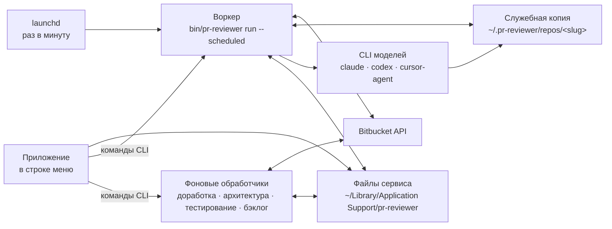

# Как устроен PR Reviewer

PR Reviewer — фоновое код-ревью открытых PR в Bitbucket. Три модели — Claude, Codex и Cursor — по очереди читают изменения, публикуют замечания, проверяют замечания друг друга и закрывают свои треды, когда код исправлен. Сервис работает на вашем Mac: launchd будит его раз в минуту, а приложение в строке меню показывает, что происходит, и даёт всем управлять.

## Из чего состоит

- **Воркер** — `bin/pr-reviewer run --scheduled`. Его каждую минуту запускает агент launchd `com.avoronin.pr-reviewer`. Воркер сам решает, пора ли проходу: поэтому интервал меняется без переустановки.
- **Служебная копия** — отдельный git-клон каждого репозитория. Ревью переключает её на голову PR; ваша рабочая копия не трогается.
- **Модели** — CLI `claude`, `codex` и `cursor-agent` в режиме только для чтения. У них нет доступа к Bitbucket: они возвращают JSON, а публикует, подписывает и привязывает замечания к строкам диффа сам сервис. MCP-серверы, хуки и сохранение сессий отключены.
- **Файлы сервиса** — состояние, статистика, очереди и отчёты (см. [data.md](data.md)).
- **Приложение в строке меню** — иконка с числом непроверенных PR и окно. Оно читает файлы сервиса, а действует только через команды CLI: всё, что можно сделать в окне, можно и из терминала (см. [cli.md](cli.md)).
- **Фоновые обработчики** — доработка по замечаниям, архитектурное ревью, тестирование в браузере и задачи бэклога. У каждого своя очередь, свой лок и свои рабочие копии, поэтому они не блокируют ревью и друг друга.

## Один проход

1. **Пора ли.** launchd будит воркер. Проход начинается, если с прошлого прошло `intervalMinutes`, если нажата кнопка ▶ (`run-now`) или если в очереди есть явные заявки. Если фоновое ревью выключено, выполняются только явные заявки.
2. **Лок и пульс.** Воркер занимает лок `worker.pid`: второй проход в это время не стартует. Каждые 30 секунд он обновляет файл `heartbeat`, а `caffeinate` не даёт Mac уснуть посреди ревью.
3. **Дорожки репозиториев.** Репозитории проверяются параллельно, до `parallelRepos` одновременно (по умолчанию 3; `1` — по очереди). Внутри репозитория всё идёт по очереди. У каждой дорожки своя рабочая папка `tmp/<slug>`.
4. **Репозиторий.** В своей дорожке для каждого подключённого репозитория:
   - явные заявки этого репозитория — ревью, заказанные кликом по иконке модели (`review`); дорожка разбирает их сама, не дожидаясь других репозиториев, и проверяет очередь ещё раз в конце;
   - запрос к Bitbucket — открытые PR с головой и числом комментариев;
   - комментарии всех PR, где они есть: из них считаются открытые и закрытые треды для окна;
   - `git fetch`, только если в клоне нет головы или целевой ветки какого-то PR;
   - снимок PR для окна (`prs/<slug>.json`), отставание веток от целевых и конфликты;
   - PR, которые закрылись с прошлого раза: исходы их замечаний и последние ответы людей для памяти;
   - обновление памяти ревьюеров по новым ответам людей;
   - ревью PR по очереди. Черновики, PR вне `branchPattern` и репозитории с выключенным фоновым ревью фоном не ревьюятся.
5. **Ревью PR.** Модели нужно работать, если на PR новая голова, появились треды, на которые она ещё не ответила, или её собственные треды пора перепроверить. Если ничего не изменилось, PR пропускается без вызова модели. Подробно — [review.md](review.md).
6. **Хвост очереди.** Заявки, пришедшие в самом конце, и заявки на неподключённые репозитории разбираются после всех дорожек.
7. **Итог.** В `status.json` записываются время и первая ошибка прохода; окно показывает её плашкой, а уведомление приходит только о первой ошибке подряд.

## Как окно узнаёт о происходящем

Приложение каждые 5 секунд перечитывает файлы сервиса и сравнивает их с тем, о чём уже уведомило. Отсюда иконка в строке состояния, бейджи замечаний, баннеры и уведомления. Если пульс прохода не обновлялся 15 минут, окно считает проход зависшим и предлагает его прервать.

Команды окно запускает через тот же `bin/pr-reviewer`, путь к которому `install.sh` записывает в приложение. Ошибки этих команд попадают в журнал с меткой `ERROR` и видны плашкой в обзоре.

## Защита от зависаний

Сеть может пропасть посреди `fetch` — Mac уснул, сменился VPN. Поэтому SSH сам рвёт мёртвое соединение примерно за минуту, а `fetch` и `clone` прерываются через 10 и 30 минут. Если проход всё же завис, пульс останавливается, и через 15 минут в обзоре появляется баннер с кнопкой «Прервать», а иконка в строке состояния становится оранжевым треугольником. «Прервать» (или `bin/pr-reviewer stop`) останавливает и зависший git сразу; следующий проход начнётся по расписанию.

## Словарь

Слова, которыми пишутся окно и документация. «Пишем» — основное слово: им пишется документация и новые подписи окна. «Допустимо» — синонимы, которые уже есть в окне; их не исправляют. «Не пишем» — слов из этой колонки нет ни в окне, ни в документации. Имена команд, полей и файлов (`pause`, `agents`, `lessons`, `qa`, `arch`) остаются как в коде. Где какой синоним стоит в окне — `product/design/terms.md`.

### PR и ревью

| Пишем | Допустимо | Не пишем | Что значит |
|---|---|---|---|
| PR | — | пулреквест, запрос на слияние | Pull request в Bitbucket |
| исходная ветка | — | — | Ветка, из которой открыт PR. Фоновое ревью берёт только те, что подходят под `branchPattern` |
| целевая ветка | база («отстала от базы») | базовая ветка | Ветка, в которую вливается PR |
| голова PR | — | — | Последний коммит исходной ветки PR |
| влит / отклонён | — | смёрджен | Состояние PR |
| ревью | проверка («идёт проверка PR») | обзор | Работа модели над PR: чтение диффа, замечания и ответы в тредах |
| модель | — | агент, нейросеть, ИИ | Claude, Codex или Cursor. Настройки моделей лежат в поле `agents` конфига |
| замечание | — | находка | То, что модель оставила в PR; корень её треда |
| комментарий | «комментарий модели» — только в технических разделах, когда речь об объекте Bitbucket: подпись, маркер, редактирование | — | Сообщение человека в Bitbucket |
| комментарии людей | комментарии ревьюеров (статистика) | — | Комментарии не от моделей |
| тред | обсуждение | ветка обсуждения | Комментарий или замечание вместе с ответами |
| ответ | — | реплика | Сообщение в уже открытом треде |
| исправлено / отклонено | — | принято, проигнорировано | Исход замечания в статистике (`addressed` / `dismissed`, см. [stats.md](stats.md)) |

### Как работает сервис

| Пишем | Допустимо | Не пишем | Что значит |
|---|---|---|---|
| сервис | — | демон | Фоновая часть PR Reviewer: агент launchd, который раз в минуту решает, пора ли проходу |
| воркер | — | — | Процесс сервиса, который выполняет проход. Только в технических разделах: [overview.md](overview.md), [data.md](data.md), [cli.md](cli.md), [install.md](install.md) |
| фоновое ревью | — | — | Ревью, которое сервис делает сам по расписанию |
| фоновое ревью выключено | пауза (подсказка значка, вывод `status`) | приостановлено | Общий переключатель «Фоновое ревью» выключен (`pause`) или выключено фоновое ревью одного репозитория (`repo pause`) |
| модель вне фонового ревью | выключенная модель | — | Модель с `auto: false`: в фоне не ревьюит, не отвечает и не закрывает свои треды |
| ручной запуск | запуск по иконке | — | Ревью одной моделью по клику на её иконку или командой `review`. Работает при выключенном фоновом ревью и для любых PR |
| явная заявка | — | — | Ручной запуск, пока он ждёт в очереди. Термин документации, в окне не пишется |
| проход | проверка («следующая проверка через N мин») | — | Один запуск воркера по всем репозиториям |
| раунд | — | — | Ревью одной головы всеми моделями фонового ревью |
| роль | — | — | Место модели в раунде: `first` ревьюит с чистого листа, `second` видит замечания предыдущих, `replies` — запуск только с ответами в тредах |
| служебная копия | клон | — | Git-клон репозитория в `~/.pr-reviewer/repos/`, с которым работает только сервис. Не путать с рабочей копией доработки и тестирования — это worktree служебной копии |

### Доработка, архитектурное ревью, тестирование

| Пишем | Допустимо | Не пишем | Что значит |
|---|---|---|---|
| доработка | автофикс (статистика) | фикс | Claude правит ветку PR по открытым замечаниям ([fix.md](fix.md)) |
| rebase | — | ребейз, перебазирование | Перенос ветки PR на свежую целевую ветку |
| проверки | — | тесты, линт | Скрипты проекта `lint`, `ts-check`, `test` после доработки и rebase |
| архитектурное ревью | архитектура (статистика) | arch | Оценка подхода PR одной моделью ([arch.md](arch.md)) |
| тестирование | — | QA | Планирование и прогон тестов по PR ([qa.md](qa.md)) |
| план, кейс, прогон | — | тест-кейс | Части тестирования |

### Память и бэклог

| Пишем | Допустимо | Не пишем | Что значит |
|---|---|---|---|
| память | «Память ревьюеров» — полное имя | уроки, lessons, база знаний | Правила репозитория, которые модели учитывают при ревью ([memory.md](memory.md)) |
| правило | — | урок, lesson | Одно положение памяти |
| разбор памяти | — | ревизия, чистка | Модель пересматривает правила и предлагает план |
| бэклог | — | — | Проблемы вне диффа PR, которые модели нашли по ходу ревью ([backlog.md](backlog.md)) |
| проблема | запись | баг | Запись бэклога. «Замечание» — только в PR |
| задача | — | тикет, issue | Задача в трекере (PROJ-1234) |
